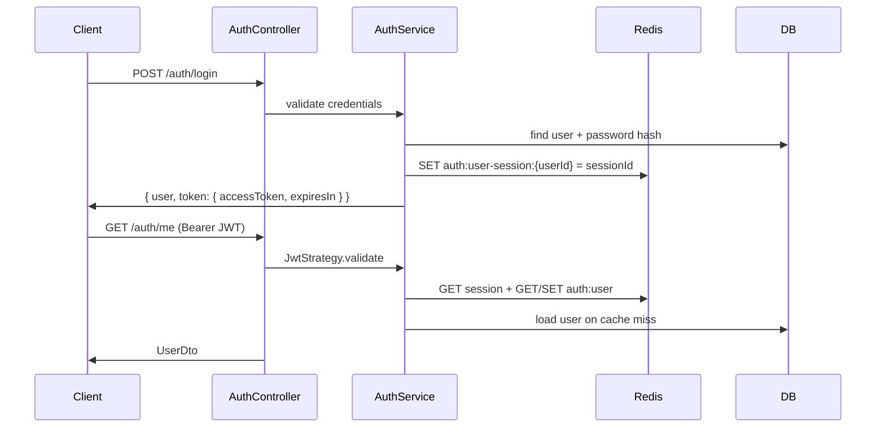

# Auth

JWT **RS256** access tokens + **Redis server session**. No refresh tokens. Related: [roles.md](./roles.md), [cache.md](./cache.md).

---

## Where logic lives

| Concern | File |
|---------|------|
| HTTP routes | `src/modules/auth/auth.controller.ts` |
| Business logic (register/login/SSO/email/reset) | `src/modules/auth/auth.service.ts` |
| Module wiring (JWT, Passport, Google) | `src/modules/auth/auth.module.ts` |
| JWT validate + Redis session check | `src/modules/auth/strategies/jwt.strategy.ts` |
| Google OAuth profile | `src/modules/auth/strategies/google.strategy.ts` |
| Public strategy | `src/modules/auth/strategies/public.strategy.ts` |
| JWT payload type | `src/modules/auth/types/jwt-access-payload.type.ts` |
| Redis key prefixes / TTLs | `src/modules/auth/auth-redis.constants.ts` |
| Login / register / reset DTOs | `src/modules/auth/dtos/*.ts` |
| Email verification entity | `src/modules/auth/entities/email-verification.entity.ts` |
| Password reset entity | `src/modules/auth/entities/password-reset-token.entity.ts` |
| Google identity entity | `src/modules/auth/entities/user-oauth-identity.entity.ts` |
| Bearer guard | `src/guards/auth.guard.ts` |
| `@Auth` / `@PublicRoute` / `@AuthUser` | `src/decorators/http.decorators.ts`, `public-route.decorator.ts`, `auth-user.decorator.ts` |
| User persistence used by auth | `src/modules/user/user.service.ts`, `user.entity.ts` |

**Change login rules →** `auth.service.ts` + `dtos/login.dto.ts`.  
**Change token claims →** `jwt-access-payload.type.ts` + `issueAccessToken` in `auth.service.ts` + `jwt.strategy.ts`.  
**Change session semantics →** `jwt.strategy.ts` + `auth-redis.constants.ts` + [cache.md](./cache.md).

---

## Flow



### JWT payload (`IJwtAccessPayload`)

| Claim | Meaning |
|-------|---------|
| `sub` | User UUID |
| `type` | `ACCESS_TOKEN` |
| `role` | `admin` \| `doctor` \| `nurse` |
| `sessionId` | Must match Redis `auth:user-session:{userId}` |
| `email` | Optional |

Default TTL: `JWT_EXPIRATION_TIME` (e.g. `86400`). New login **replaces** previous session (single active session per user).

`REDIS_CACHE_ENABLED=true` is required. If Redis is off: login → `503`, JWT → `401 Session expired`.

---

## Endpoints

### Public

| Method | Path | Body | Notes |
|--------|------|------|-------|
| `POST` | `/auth/register` | `{ username, password, email? }` | Default role `nurse` |
| `POST` | `/auth/login` | `{ username, password }` | `username` field; lookup via identifier (username or verified email) |
| `POST` | `/auth/forgot-password` | `{ email }` | Generic message |
| `POST` | `/auth/reset-password` | `{ token, newPassword }` | Invalidates session |
| `GET` | `/auth/google` | — | OAuth start |
| `GET` | `/auth/google/callback` | — | Issues JWT |

### Authenticated (`Authorization: Bearer`)

| Method | Path | Notes |
|--------|------|-------|
| `GET` | `/auth/me` | Current user |
| `POST` | `/auth/update-email` | Requires later verification |
| `POST` | `/auth/request-email-verification` | `otp` \| `link` |
| `POST` | `/auth/verify-email` | Completes verification |

Login response shape:

```json
{
  "user": { "id": "...", "username": "...", "role": "admin", "isActive": true },
  "token": { "accessToken": "<jwt>", "expiresIn": 86400 }
}
```

---

## Rules & behaviors

- Username: lowercase, 3–64, `[a-z0-9_]`; password min 8.
- Inactive users cannot log in.
- Email verification / reset tokens: hashed in DB; **mailer not wired** — secrets logged in dev (`AuthService.createEmailVerification` / forgot-password).
- Google: link by oauth identity → else email → else create user.
- Password reset deletes Redis session key.

Protect routes: see [roles.md](./roles.md). Inject user: `@AuthUser() user: UserEntity`.

---

## Env (auth-related)

```env
JWT_EXPIRATION_TIME=86400
JWT_PRIVATE_KEY=...
JWT_PUBLIC_KEY=...
REDIS_CACHE_ENABLED=true
REDIS_HOST=127.0.0.1
REDIS_PORT=6379
RESET_TOKEN_TTL_MINUTES=30
EMAIL_VERIFY_TTL_MINUTES=15
GOOGLE_CLIENT_ID=
GOOGLE_CLIENT_SECRET=
GOOGLE_CALLBACK_URL=http://localhost:8081/auth/google/callback
```

Seed admin (migration): `admin` / `0123456789` — rotate in production.
